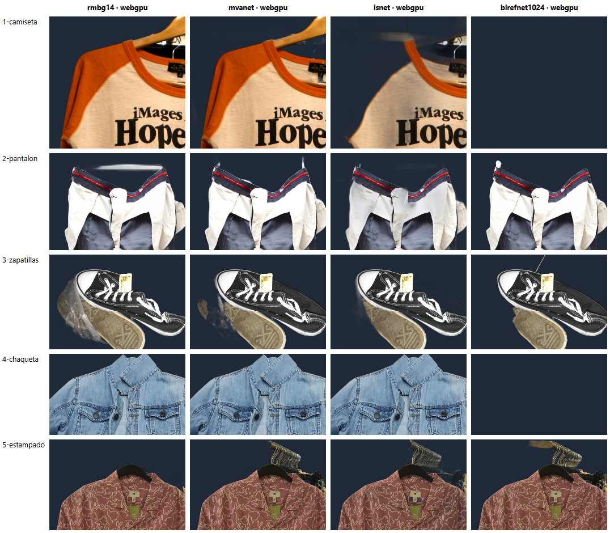
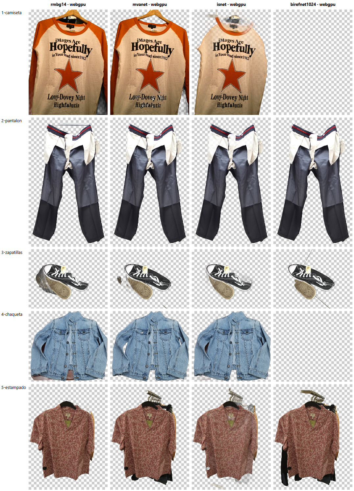
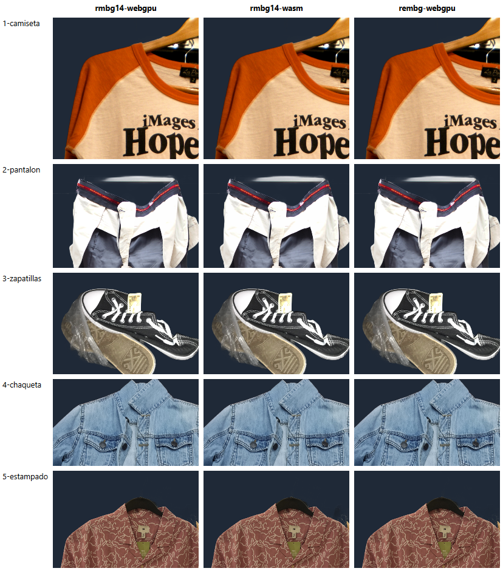
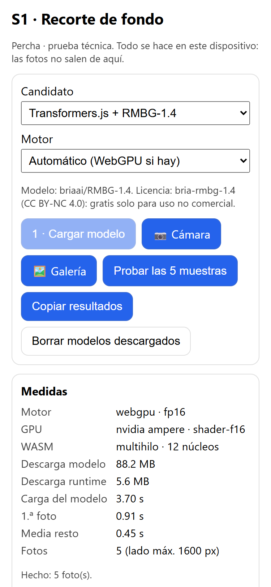
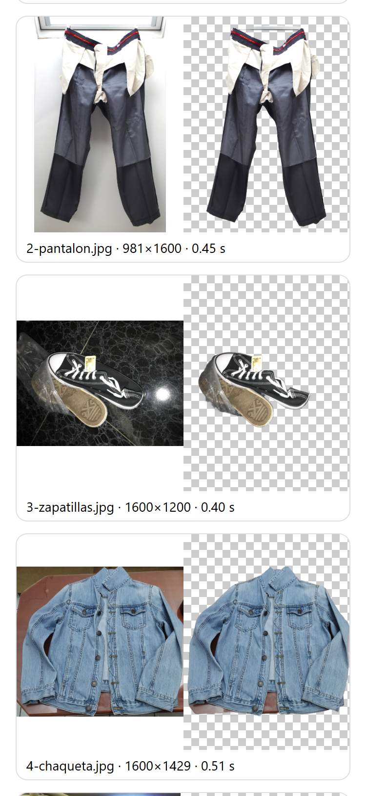

# S1 — Recorte de fondo en el navegador

Fecha: 2026-11-02 · Rama `spike/s1-recorte` · Código en [`spikes/s1-recorte/`](../../spikes/s1-recorte/)

## Resumen

**Recomendación: Transformers.js (`@huggingface/transformers` 4.3) con `briaai/RMBG-1.4`, cargado a mano
(sin `rembg-webgpu`).** fp16 en WebGPU (88 MB) y q8 en WASM (44 MB) cuando el móvil no tiene WebGPU.
En el PC es el más rápido (0,5 s por foto en WebGPU, 3,3 s en CPU), empata en calidad con MVANet y es el
más fiable con un fondo lleno de cosas. Sin WebGPU, su versión q8 pesa 44 MB y recorta igual de bien.
Su licencia es **no comercial**: vale para Percha (uso privado y gratis), no para venderla.
Plan B con licencia libre (MIT), **solo con WebGPU**: **MVANet** (`onnx-community/MVANet-ONNX`, q4f16,
85 MB), el doble de lento; en CPU tarda ~28 s por foto.

`rembg-webgpu` **no aporta nada**: por dentro es Transformers.js cargando el mismo RMBG-1.4, y además
parchea el `fetch` global de la página.

Falta la prueba en un **Android real**: pasos y tabla al final.

## Candidatos

| Candidato | Modelo | Descarga (modelo) | WebGPU | WASM | Licencia del modelo |
|---|---|---|---|---|---|
| `rembg-webgpu` 0.2.1 | `briaai/RMBG-1.4` (la librería lo carga por dentro) | 88 MB fp16 / 176 MB fp32 | ✅ | ✅ (fp32) | bria-rmbg-1.4 = CC BY-NC 4.0 (no comercial). La librería pide crédito visible a rembg.com |
| Transformers.js + RMBG-1.4 | `briaai/RMBG-1.4` | 88 MB fp16 · 44 MB q8 | ✅ | ✅ | CC BY-NC 4.0 (no comercial) |
| Transformers.js + ISNet (DIS) | `onnx-community/ISNet-ONNX` | 88 MB fp16 · 44 MB q8 | ✅ | ✅ | La ficha de HF dice AGPL-3.0; el repo original DIS es Apache-2.0 |
| Transformers.js + MVANet | `onnx-community/MVANet-ONNX` | 85 MB q4f16 · 125 MB q4 | ✅ | ✅ | MIT |
| Transformers.js + BiRefNet lite | `onnx-community/BiRefNet_lite-ONNX` | 115 MB fp16 · 224 MB fp32 | ❌ | ❌ | MIT |
| Transformers.js + BiRefNet lite 1024 parcheado | `jiabins0303/birefnet-lite-1024-webgpu` | 115 MB fp16 | ⚠️ | ❌ | MIT |

Búsqueda de «algo mejor en 2026»: los candidatos con licencia libre que más se citan son BiRefNet lite,
MVANet, ISNet, BEN2 e InSPyReNet. BEN2 (219 MB, solo fp16) e InSPyReNet (199 MB) se descartan sin medir
por tamaño: en un móvil, más de ~120 MB es demasiado. RMBG-2.0 es BiRefNet reentrenado por BRIA, con la
misma licencia no comercial y más pesado. MODNet (13 MB) solo sirve para personas.

## Fotos de prueba

**No son fotos del usuario**: son 5 fotos libres de Wikimedia Commons, elegidas para parecerse a una foto
de móvil (prenda colgada o en una mesa, con fondo real, no de estudio). Se bajan con
`node scripts/descargar-muestras.mjs` a `spikes/s1-recorte/muestras/`, que está ignorada por git.

| Foto | Qué tiene de difícil | Autor · licencia |
|---|---|---|
| 1-camiseta | percha y fondo oscuro, cortada por los bordes | Jennifer Morrow · CC BY 2.0 |
| 2-pantalon | pinzas y ventana detrás, interior gris | Kotivalo · CC0 |
| 3-zapatillas | suelo brillante con reflejo, bolsa de plástico, etiqueta | Kid Keen 47 · CC BY-SA 4.0 |
| 4-chaqueta | sobre una mesa de madera, mangas que tocan el borde | NikosLikomitros · CC0 |
| 5-estampado | tienda llena de ropa detrás, perchas, etiqueta | Peachyeung316 · CC BY-SA 4.0 |

## Método

- PC: Intel i5-11600K (12 hilos), NVIDIA RTX 3060, Windows 11, **Chrome 156**. Página servida con
  `vite --host` y HTTPS (`@vitejs/plugin-basic-ssl`), con COOP/COEP para que WASM use varios hilos.
- `node scripts/medir.mjs` abre Chrome con Playwright y **un perfil limpio por candidato** (primera carga
  real, sin nada en caché), recorta las 5 fotos y vuelve a cargar la página para medir la carga desde caché.
- Cada foto se reduce antes a **1600 px de lado** (como hará la app al guardarla). El tiempo por foto va de
  la foto original al PNG transparente: reducir + inferencia + aplicar la máscara + codificar el PNG.
- **Descarga**: bytes que pide Transformers.js a la red (modelo de Hugging Face + runtime ONNX de
  jsDelivr, 5,6 MB comprimido). No incluye el JS de la propia página.
- **Primera carga**: desde pedir el modelo hasta tenerlo listo (descarga + compilación). Depende de la red:
  aquí, fibra. **Carga en caché**: lo mismo con el modelo ya en la Cache API del navegador.
- La 1.ª foto es más lenta porque WebGPU compila los *shaders*: se da aparte.

## Resultados en el PC

Descarga = modelo + runtime ONNX. «Resto» = media de las otras 9 fotos (4 de la primera pasada y 5 de la
pasada con el modelo en caché), con el mínimo y el máximo.

**WebGPU (RTX 3060, fp16 con `shader-f16`)**

| Candidato | Pesos | Descarga | 1.ª carga | Carga en caché | 1.ª foto | Resto por foto | Borde (1–5) |
|---|---|---|---|---|---|---|---|
| **Transformers.js + RMBG-1.4** | fp16 | 88 + 5,6 MB | 4,0 s | 0,7 s | 0,9 s | **0,5 s** (0,4–0,5) | **4** |
| rembg-webgpu | fp16 | 88 + 5,6 MB | 3,9 s | 0,8 s | 1,2 s | 0,7 s (0,6–0,8) | 4 (mismo modelo) |
| ISNet | fp16 | 88 + 5,6 MB | 3,9 s | 0,6 s | 0,9 s | 0,6 s (0,5–0,7) | 2 |
| MVANet | q4f16 | 85 + 5,6 MB | 4,6 s | 1,1 s | 2,2 s | 1,1 s (1,0–1,1) | 4 |
| BiRefNet lite 1024 parcheado | fp16 | 115 + 5,6 MB | 11,5 s | 7,4 s | 4,5 s | 1,6 s (1,5–1,8) | 1 (2 de 5 vacías) |
| BiRefNet lite (`onnx-community`) | fp16 | — | — | — | — | no corre | — |

**WASM (CPU, 12 hilos)**

| Candidato | Pesos | Descarga | 1.ª carga | Carga en caché | 1.ª foto | Resto por foto | Borde (1–5) |
|---|---|---|---|---|---|---|---|
| **Transformers.js + RMBG-1.4** | q8 | **44** + 5,6 MB | 2,7 s | 0,5 s | 3,5 s | **3,3 s** (3,1–3,5) | 4 (como fp16) |
| rembg-webgpu | fp32 (no deja elegir) | 176 + 5,6 MB | 4,1 s | 0,6 s | 5,4 s | 7,7 s (4,8–10,1) | 4 |
| ISNet | q8 | 44 + 5,6 MB | 2,8 s | 0,3 s | 3,6 s | 3,4 s (3,2–3,9) | 2 |
| MVANet | q4 | 125 + 5,6 MB | 5,6 s | 1,2 s | 28,4 s | 27,4 s (25,5–30,1) | — |
| BiRefNet lite (`onnx-community`) | fp32 | 224 MB | — | — | — | `std::bad_alloc` | — |

En un móvil todo irá bastante más lento (de 3× a 10× según el móvil): por eso hace falta la prueba en
Android. Lo que sí se ve ya en el PC es el **orden**: RMBG-1.4 es el más rápido en los dos motores, y es el
único con un plan B en WASM que pesa poco (44 MB) y recorta igual.

El JS de la página con Transformers.js son 553 kB (161 kB con gzip); el runtime ONNX en WASM, 27 MB
(6,8 MB comprimido), se baja una vez y queda en caché.

### Calidad del borde

Nota a ojo, de 1 a 5, mirando los recortes a tamaño real sobre fondo oscuro (lo que más delata halos).





- **RMBG-1.4 (4)**: bordes limpios y sin halo, también en el estampado. Fallo típico: **se queda cosas que
  no son la prenda** pero van pegadas a ella: la percha, la bolsa de plástico de las zapatillas, la varilla
  de la ventana sobre el pantalón y una franja de la mesa bajo la chaqueta. Es el mejor con la tienda llena
  de ropa detrás (foto 5): solo deja la camisa y su percha.
- **MVANet (4)**: el borde más nítido, y quita mejor la mesa y la varilla. Pero en la tienda **se queda las
  perchas y la ropa de detrás**, y deja una mancha de la bolsa en las zapatillas.
- **ISNet (2)**: bordes blandos, la camiseta sale **medio transparente** y deja nubes de fondo (percha de la
  camiseta, chaqueta, estampado).
- **BiRefNet lite 1024 (1)**: muy nítido cuando funciona, pero en la camiseta y la chaqueta devolvió la
  máscara **vacía**, y en la tienda también se queda la ropa de detrás.
- **q8 en WASM frente a fp16 en WebGPU** (RMBG-1.4): no se nota la diferencia.
  `rembg-webgpu` da exactamente el mismo recorte.



Para Percha, los restos pegados (percha, bolsa) importan poco: el usuario puede hacer la foto sin ellos y,
más adelante, borrar a mano. Lo grave sería comerse trozos de la prenda o dejar media tienda: ahí RMBG-1.4
es el más fiable de los cinco.

### La página a 375 px




## Hallazgos

- **`rembg-webgpu` es un envoltorio fino de Transformers.js**: carga `briaai/RMBG-1.4` con
  `AutoModel.from_pretrained` y lo compone en un *worker*. Su README habla del modelo «destilado» de
  rembg.com y de 40–50 MB, pero el código pide RMBG-1.4 (88 MB en fp16, 176 MB en WASM, donde siempre usa
  fp32). Además sustituye `window.fetch` para contar el progreso (con
  Transformers.js 4 ese parche ni siquiera ve las descargas) y exige un crédito visible a rembg.com. Usar
  Transformers.js directamente da lo mismo con más control: un poco más rápido, elegir q8 en WASM y
  liberar memoria.
- **BiRefNet lite tal cual no corre en WebGPU**: «Too many storage buffers in shader. Current: 17, Max is
  16». El *export* parcheado de 2026 (`jiabins0303/birefnet-lite-1024-webgpu`) sí corre, pero en el PC tardó
  3× más que RMBG-1.4, compila 7 s cada vez que se abre la página y **devolvió la máscara vacía en 2 de las
  5 fotos** (camiseta y chaqueta). Su autor avisa de que no ha comprobado que WebGPU dé lo mismo que la CPU.
  No es para móviles todavía.
- **RMBG-1.4 en Transformers.js 4** no funciona con `pipeline('background-removal')`: «Unsupported model
  type "SegformerForSemanticSegmentation"». Se carga como en su ficha: `AutoModel` con `config: {
  model_type: 'custom' }` y `AutoProcessor` con la configuración a mano. Está en `src/candidatos.ts`.
- **BiRefNet lite en WASM** (fp32, 224 MB) revienta la memoria de ONNX Runtime (`std::bad_alloc`, el heap
  de WASM es de 32 bits). **MVANet en WASM** funciona, pero a ~28 s por foto en el PC: inservible.
- La salida de `pipeline(...)` es un `OffscreenCanvas` (`convertToBlob`, no `toBlob`).
- **WASM sin COOP/COEP va con un solo hilo.** En la app habrá que servir `Cross-Origin-Opener-Policy:
  same-origin` y `Cross-Origin-Embedder-Policy: credentialless` (Cloudflare Pages lo permite con un fichero
  `_headers`).

## Para la app (T1.2)

- Transformers.js + RMBG-1.4 detrás de una interfaz `Recortador` en `src/recorte/`, en un **Web Worker**
  para no congelar la pantalla mientras recorta.
- Motor: WebGPU si hay adaptador; fp16 si tiene `shader-f16`, si no fp32. Sin WebGPU, WASM con q8.
- Descargar el modelo **solo cuando haga falta** (primera prenda), con barra de progreso y aviso del tamaño
  («Se descargan 90 MB una sola vez. Mejor con wifi.»). Queda en la Cache API; pedir
  `navigator.storage.persist()` para que Chrome no lo borre.
- Reducir la foto a ~1600 px antes de recortar y guardar el PNG (o WebP con alfa) ya recortado.
- Si el recorte sale mal, dejar guardar la foto sin recortar.
- El runtime ONNX viene de jsDelivr y el modelo de Hugging Face: se puede servir desde la propia PWA más
  adelante si se quiere que funcione sin esas webs.

## Prueba en Android (la hace el usuario)

Tarda unos 20 minutos. Mejor con wifi: cada modelo son ~90 MB.

1. El PC y el móvil, en **la misma wifi**.
2. En el PC, en `spikes/s1-recorte/`: `npx -y pnpm@9 install`, `node scripts/descargar-muestras.mjs` y
   `npx -y pnpm@9 dev`. Apunta la línea `Network: https://192.168.x.x:5173/` (hoy era
   `https://192.168.18.123:5173/`). Si Windows pregunta por el cortafuegos, permite **redes privadas**.
3. En el móvil, abre esa dirección en **Chrome**. Saldrá «La conexión no es privada» (el certificado es de
   prueba): **Configuración avanzada → Acceder a 192.168.x.x (sitio no seguro)**.
4. Mira el bloque **Medidas**: la línea **GPU** dice si el móvil tiene WebGPU (si pone «—», irá por WASM).
5. Candidato **Transformers.js + RMBG-1.4**, motor **Automático**. Pulsa **1 · Cargar modelo** y espera a
   «Modelo listo».
6. Pulsa **Probar las 5 muestras** y espera a «Hecho: 5 foto(s)».
7. Pulsa **📷 Cámara** y haz 2–3 fotos de ropa tuya (una prenda por foto, colgada o en la cama). Mira el
   recorte sobre los cuadros: ¿se come trozos de la prenda? ¿deja fondo pegado?
8. Pulsa **Copiar resultados** y pégalo en una nota (o mándatelo): es una fila de la tabla de abajo.
9. **Recarga la página** y repite 5–6 para medir la carga desde caché («Descarga modelo» debería quedarse
   en 0 MB). Copia otra vez.
10. Repite 5–9 con **Transformers.js + MVANet**, y luego con **RMBG-1.4** y motor **Forzar WASM (CPU)**
    (es lo que verá un móvil sin WebGPU).
11. Si la pestaña se cierra sola («¡Vaya!») o el móvil se calienta mucho, apúntalo en Notas.
12. Pásame la tabla y 1–2 capturas de los recortes de tu ropa; con eso cierro S1.

Si la página no carga desde el móvil, un plan B: conectar el móvil por USB, abrir `chrome://inspect` en el
PC, **Port forwarding** `5173 → localhost:5173`, y en el móvil abrir `https://localhost:5173/`.

| Móvil y Chrome | Candidato | Motor (lo pone la página) | Descarga | Carga 1.ª vez | Carga en caché | 1.ª foto | Media resto | Borde (1–5) | Notas |
|---|---|---|---|---|---|---|---|---|---|
| | RMBG-1.4 | Automático → | | | | | | | |
| | MVANet | Automático → | | | | | | | |
| | RMBG-1.4 | WASM | | | | | | | |
| | rembg-webgpu (opcional) | Automático → | | | | | | | |

**Qué decide la prueba:** si con RMBG-1.4 la media por foto queda por debajo de ~5 s y la primera carga
por debajo de ~1 min con wifi, se confirma la recomendación. Si el móvil no tiene WebGPU y WASM pasa de
~15 s por foto, habría que bajar la resolución del modelo o recortar en segundo plano mientras el usuario
etiqueta la prenda.

## Cómo reproducirlo

```bash
cd spikes/s1-recorte
npx -y pnpm@9 install
node scripts/descargar-muestras.mjs
npx -y pnpm@9 dev
node scripts/medir.mjs            # en otra terminal: mide todo; deja medidas y recortes en resultados/
node scripts/captura-comparar.mjs "?c=rmbg14,mvanet&fondo=oscuro" bordes.png
node scripts/captura-movil.mjs rmbg14
```

`https://localhost:5173/comparar.html` enseña los recortes guardados lado a lado (`?vista=completa`,
`?fondo=oscuro`, `?motor=wasm`).
