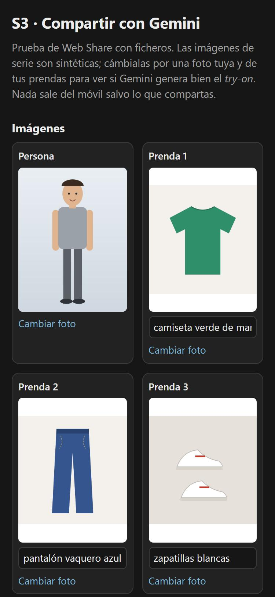
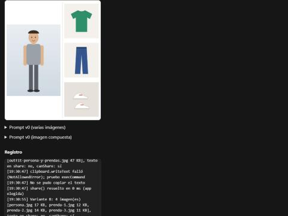

# S3 — Compartir con la app de Gemini

Fecha: 2026-11-02 · Rama `spike/s3-compartir` · Código en [`spikes/s3-compartir/`](../../spikes/s3-compartir/)

**Pregunta:** ¿puede Percha mandar la foto del usuario, las prendas del outfit y un texto ya escrito a la app
de Gemini del móvil con Web Share (`navigator.share({ files, text })`), para que la cuenta del propio usuario
genere el *try-on*?

**Estado:** página lista y comprobada en el PC. **Falta la prueba en un Android real** (pasos y tabla abajo):
sin ella no hay respuesta a la pregunta.

## La página

Vite + TypeScript sin framework, HTTPS con `@vitejs/plugin-basic-ssl`. Al cargar dibuja en canvas cuatro
imágenes sintéticas (persona, camiseta, pantalón, zapatillas) y una imagen compuesta; cada hueco tiene
«Cambiar foto» para usar fotos reales desde la galería o la cámara, y un campo con la descripción de la
prenda, que entra en el prompt. Las fotos se normalizan a JPEG (orientación EXIF aplicada, lado máximo
1536 px). La casilla «Incluir la prenda 3» prueba con 3 imágenes en vez de 4.

| Variante | Ficheros | Texto |
|---|---|---|
| **A** | persona + 2–3 prendas (3–4 JPEG) | en `share()` |
| **B** | persona + 2–3 prendas (3–4 JPEG) | al portapapeles; se pega a mano en la app |
| **C** | una sola imagen compuesta (persona a la izquierda, prendas en columna a la derecha, 1200×1500) | en `share()` |
| **D** | la misma imagen compuesta | al portapapeles |

Antes de cada `share()` se llama a `navigator.canShare(datos)`; el resultado, los ficheros con su tamaño, la
respuesta de `share()` (resuelta o `AbortError`/`NotAllowedError`…) y el tiempo van a un **registro** en la
página, con un botón «Copiar registro». Las imágenes se preparan antes del clic para no agotar la activación
por gesto que exige `share()`.



Imagen compuesta (C y D) con las sintéticas:



## Comprobado en el PC

- `tsc --noEmit` y `vite build` en verde (`pnpm build`).
- El navegador integrado de Claude (Chromium/Electron, viewport 375 px) **no tiene `navigator.share` ni
  `canShare`**: la página lo detecta y lo dice en el registro. Además no acepta el certificado autofirmado,
  así que para el PC hay `pnpm dev:pc` (HTTP en `localhost:5184`, que ya es contexto seguro).
- Con `share`/`canShare` simulados por consola, cada variante manda lo esperado: A y B, 4 JPEG
  (`persona.jpg`, `prenda-1..3.jpg`, 11–17 KB las sintéticas); C y D, 1 JPEG de 47 KB; A y C con el texto, B y D
  sin él. Con la prenda 3 desactivada, 3 imágenes y el prompt dice «Te paso 3 imágenes…».
- Copiar al portapapeles: en el navegador integrado `clipboard.writeText` da `NotAllowedError` y entra el
  respaldo `execCommand('copy')`, que sí copia con un clic real. En Chrome Android se espera que
  `writeText` funcione con el gesto; el registro dirá cuál se usó.
- Cambiar foto: una PNG de 3000×4000 se queda en JPEG de 1152×1536 y la imagen compuesta se rehace.
- **No probado:** la hoja de compartir real (ni en Windows ni en Android), y nada de lo que hace Gemini o
  ChatGPT al recibir los datos.

## Lo que se espera ver en Android (hipótesis, sin confirmar)

- Chrome Android admite Web Share con ficheros de imagen; la hoja de compartir muestra las apps que aceptan
  imágenes (con varias, solo las que aceptan varias a la vez).
- Con imágenes y texto juntos, Android manda el texto como extra del *intent*; muchas apps lo ignoran cuando
  hay imágenes. Por eso B y D copian el texto al portapapeles.
- Si Gemini solo acepta una imagen, C/D son la salida: un solo fichero con todo.
- Gemini puede negarse a editar fotos de personas en algunos casos; el prompt va en primera persona («una foto
  mía») porque es el propio usuario quien lo envía.

## Prueba en Android (la hace el usuario)

1. PC y móvil en la **misma wifi**. En el PC:
   ```bash
   cd spikes/s3-compartir
   pnpm install
   pnpm dev
   ```
   (Si `pnpm` no está en el PATH: `npx pnpm@latest install` y `npx pnpm@latest dev`.) Si Windows pregunta por
   el cortafuegos, permite el acceso en redes privadas.
2. Apunta la URL **Network** que sale (en este PC fue `https://192.168.18.123:5183`) y ábrela en **Chrome**
   del móvil. Saldrá un aviso de certificado: «Configuración avanzada» → «Acceder a … (sitio no seguro)».
3. Baja hasta **Registro**: deben salir `navigator.share: sí`, `navigator.canShare: sí` y `canShare A/B/C/D: sí`.
   Si sale `share: no` o `Contexto seguro: no`, usa el plan B de abajo.
4. Cambia la **Persona** por una foto tuya de **cuerpo entero** y las **Prendas** por fotos de 2–3 prendas tuyas
   (mejor sobre fondo liso). Corrige la descripción de cada prenda (p. ej. «sudadera gris con capucha»).
5. Pulsa **A**. Anota si **aparece Gemini** en la hoja de compartir. Elige Gemini y mira: ¿cuántas imágenes
   llegan?, ¿está el texto en la caja de escribir? Envía (si el texto no llegó, escríbelo o pégalo desde la
   sección «Prompt v0» de la página). Anota si **genera la imagen** y si mantiene tu cara y cuerpo y las prendas.
6. Vuelve a Chrome y repite con **B** (al abrir Gemini, mantén pulsada la caja de texto → **Pegar**), **C** y **D**.
7. Si tienes **ChatGPT**, repite A–D eligiendo ChatGPT.
8. Pulsa **Copiar registro** y pégalo debajo de la tabla (o pásaselo a Claude), junto con 1–2 capturas de lo que
   generó Gemini (sin fotos tuyas en el repo si no quieres: basta con describirlo).

**Plan B si `share` no aparece** (el certificado no basta): cable USB con depuración USB activada, y en el PC
`adb reverse tcp:5184 tcp:5184` + `pnpm dev:pc`; en el móvil abre `http://localhost:5184` (localhost es
contexto seguro sin certificado).

### Tabla para rellenar

Móvil y versión de Android: … · Chrome: … · Gemini (versión de la app): … · ChatGPT: …

| Variante | App | ¿Aparece la app? | ¿Llegan todas las imágenes? | ¿Llega el texto? | ¿Genera la imagen? | ¿Cara y cuerpo fieles? | ¿Prendas fieles? | Notas |
|---|---|---|---|---|---|---|---|---|
| A · varias + texto | Gemini | | | | | | | |
| B · varias + portapapeles | Gemini | | | (pegado) | | | | |
| C · compuesta + texto | Gemini | | | | | | | |
| D · compuesta + portapapeles | Gemini | | | (pegado) | | | | |
| A · varias + texto | ChatGPT | | | | | | | |
| B · varias + portapapeles | ChatGPT | | | (pegado) | | | | |
| C · compuesta + texto | ChatGPT | | | | | | | |
| D · compuesta + portapapeles | ChatGPT | | | (pegado) | | | | |

Registro copiado:

```
(pega aquí)
```

### Cómo decidir con la tabla

- Si **A** funciona en Gemini (todas las imágenes y el texto) → T3.2 usa A.
- Si llegan las imágenes pero no el texto → **B**: copiar el texto y avisar con un mensaje «Texto copiado:
  pégalo en Gemini».
- Si solo llega una imagen → **C** (o **D** si tampoco llega el texto).
- Si Gemini no aparece o no genera nada → último recurso: guardar las imágenes en la galería, copiar el texto
  y que el usuario abra Gemini a mano. Habría que replantear D7 en `spec.md`.

## Prompt v0 del *try-on*

Lo genera [`src/prompt.ts`](../../spikes/s3-compartir/src/prompt.ts) con las descripciones de las prendas
(en la app saldrán de las etiquetas de cada Prenda). Ejemplo con 3 prendas:

**Varias imágenes (A, B):**

```
Te paso 4 imágenes. La primera es una foto mía. Las otras 3 son prendas de ropa: camiseta verde de manga corta, pantalón vaquero azul, zapatillas blancas.

Crea una imagen fotorrealista de mí llevando puesto este outfit completo.
- Mantén mi cara, mi pelo, mi tono de piel, mi cuerpo y mis proporciones exactamente como en la foto: no cambies mis rasgos, mi edad, mi altura ni mi talla.
- Copia cada prenda tal cual: color, estampado, tejido, largo y corte. No añadas otras prendas ni accesorios; si falta alguna parte (por ejemplo, el calzado), elige algo sencillo y neutro que combine.
- Plano de cuerpo entero, de pie y de frente, con luz natural y fondo liso claro.
- Sin texto ni marcas de agua.
```

**Imagen compuesta (C, D):** igual, cambiando la primera frase por

```
Te paso una imagen: a la izquierda estoy yo y a la derecha, en columna, unas prendas de ropa: camiseta verde de manga corta, pantalón vaquero azul, zapatillas blancas.
```

Por qué así: empieza por «Crea una imagen» para que Gemini genere en vez de describir; nombra qué imagen es
cada cosa; pide de forma explícita no tocar cara ni cuerpo (el fallo típico es «embellecer» o adelgazar);
plano de cuerpo entero para que se vean todas las prendas. Ajustarlo con lo que salga en la tabla.

## Resultado

Pendiente de la prueba en Android. Con la tabla rellena se elige variante y prompt para T3.2.
